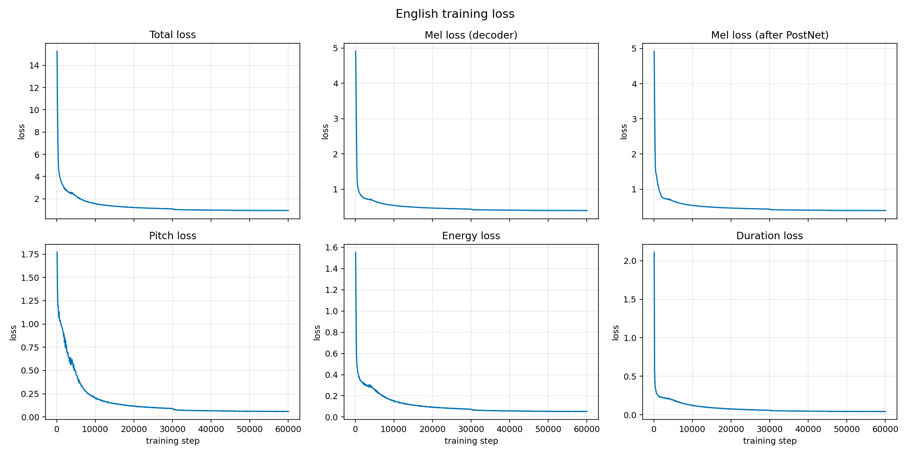
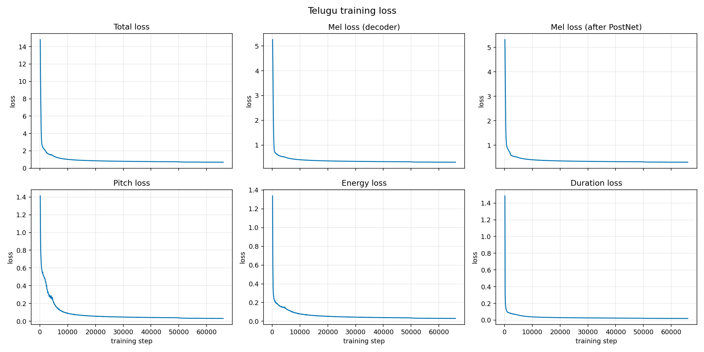
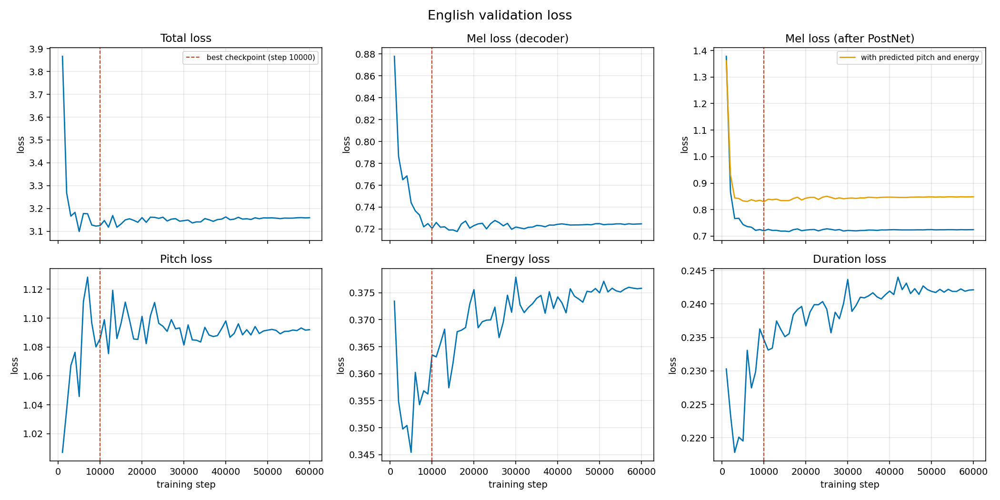
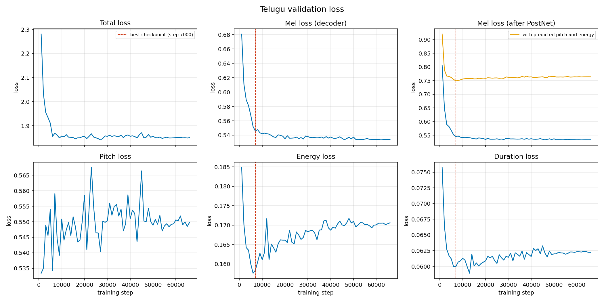
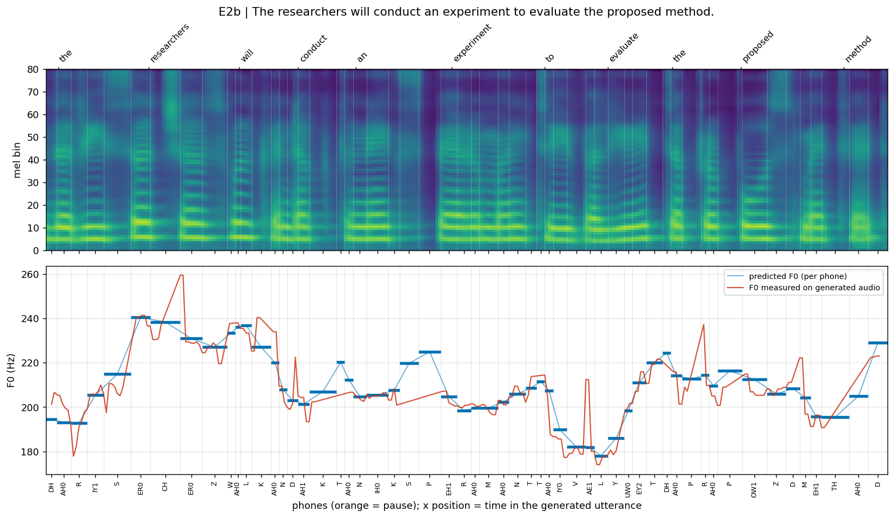

# 🗣️ FastSpeech 2 Text-to-Speech for English and Telugu

## 📖 Project Overview

This project implements and evaluates the **FastSpeech 2** text-to-speech (TTS) model separately for **English** and **Telugu**, starting from the PyTorch reference implementation [ming024/FastSpeech2](https://github.com/ming024/FastSpeech2).

Two independent models are trained, one per language. The **English model** learns from **Svarah**, a corpus of Indian-accented English with many speakers. The **Telugu model** learns from **IndicTTS Telugu**, studio recordings of a native Telugu speaker. Each model gets about **5 hours** of training audio and about **1 hour** of validation audio, and the two sets never share a clip or a sentence.

For each language, the repository contains:

- the complete **preprocessing, training and inference** code, with its own configuration file;
- the **trained checkpoint**;
- **training and validation loss** plots;
- generated audio for the **five test sentences**;
- **variance-adaptor plots** of the predicted **duration, pitch (F0) and energy** for every test sentence.

The mel-spectrograms predicted by FastSpeech 2 are turned into audio with the pretrained **HiFi-GAN universal vocoder**.

📄 **Read the full Technical Report:** [Report/Technical_Report.pdf](./Report/Technical_Report.pdf)

---

## 📑 Table of Contents

- [🧠 Model Overview](#model-overview)
- [📊 Datasets](#datasets)
- [📦 Data Selection & Splitting](#data-selection-and-splitting)
- [🔤 Text Front-Ends](#text-front-ends)
- [🛠️ Preprocessing Pipeline](#preprocessing-pipeline)
- [🏗️ Model Architecture & Modifications](#model-architecture)
- [🏋️ Training](#training-setup)
- [📈 Results](#results)
  - [📉 1. Loss Curves](#loss-curves)
  - [🎯 2. Checkpoint Selection](#checkpoint-selection)
  - [🔊 3. Generated Test Sentences](#test-sentences)
  - [🎼 4. Variance-Adaptor Plots](#variance-plots)
  - [🗣️ 5. Objective Intelligibility Check](#intelligibility)
- [⚠️ Limitations & Possible Improvements](#limitations)
- [⚙️ Installation & Usage](#installation-and-usage)
  - [📥 1. Download Requirements](#download-requirements)
  - [📁 2. Project Structure](#project-structure)
  - [📖 3. File & Folder Explanation](#file-and-folder-explanation)
  - [⬇️ 4. Clone Repository](#clone-repo)
  - [📂 5. After Cloning](#after-cloning)
  - [🛠️ 6. Install Dependencies](#install-dependencies)
  - [🧹 7. Run Preprocessing](#run-preprocessing)
  - [🚀 8. Run Training](#run-training)
  - [🔊 9. Run Inference](#run-inference)
- [✅ Conclusion](#conclusion)

---

<a id="model-overview"></a>

## 🧠 Model Overview

| Language | Dataset | Training data | Validation data | Speakers | Released checkpoint | Inference voice |
| -------- | ------- | ------------- | --------------- | -------- | ------------------- | --------------- |
| English | Svarah | 4.99 h, 3,391 clips | 1.00 h, 646 clips | 114 | `final.pt` (step 60,000) | `S006`, durations × 1.078, pauses × 1.819 |
| Telugu | IndicTTS Telugu (male voice) | 5.00 h, 2,570 clips | 1.00 h, 520 clips | 1 speaker, 4 recording-session IDs | `final.pt` (step 66,000) | `male_a` |

Both models use exactly the same FastSpeech 2 architecture and code. What differs between them is the text front-end, the forced-alignment setup, the configuration and the data.

---

<a id="datasets"></a>

## 📊 Datasets

| Language | Dataset | Source | License |
| -------- | ------- | ------ | ------- |
| English | **Svarah**: Indian-accented English speech with speaker metadata | [Hugging Face: ai4bharat/Svarah](https://huggingface.co/datasets/ai4bharat/Svarah) · [Paper](https://arxiv.org/abs/2305.15760) | CC BY 4.0 |
| Telugu | **IndicTTS Telugu**: Telugu monolingual recordings from the Indic TTS database (IIT Madras), Hugging Face parquet release | [Indic TTS database](https://www.iitm.ac.in/donlab/indictts/database) | [Indic TTS license](https://www.iitm.ac.in/donlab/indictts/downloads/license.pdf) |

Svarah comes as a single split of 6,656 clips. It was made as a test set for speech recognition, so for this project it is subsampled into separate training and validation sets. IndicTTS Telugu has 8,576 clips from one male and one female speaker, and only the **male** recordings are used (`gender = 1`).

Both datasets are read directly from their parquet files (`<dataset>/data/*.parquet`).

---

<a id="data-selection-and-splitting"></a>

## 📦 Data Selection & Splitting

The assignment asks for about 5 h of training audio and 1 h of validation audio per language, with no overlap. Both selection pipelines are controlled by the `data:` section of each `config.yaml`, with seed `1234`.

### English (Svarah)

The recording quality in Svarah varies a lot, so the clips are ranked by quality before the 6-hour budget is filled:

1. **Hard filters.** A clip must last 1–18 s, have a speaking rate of 0.6–4.6 words/s, contain at most 0.2% clipped samples and have at least 20% voiced frames.
2. **Quality score.** Each clip is scored with the torchaudio **SQUIM** estimators and two simple signal measures, weighted 0.35 for SI-SDR, 0.25 for PESQ, 0.15 for STOI, 0.15 for an SNR estimate and 0.10 for a high-frequency ratio. The worst 12% of the pool is dropped.
3. **Forced alignment.** The clips are aligned with the Montreal Forced Aligner (`english_us_arpa`), and clips below the 3rd percentile of alignment log-likelihood are dropped.
4. **Final ranking.** The remaining clips are ranked by `quality + 0.5 × z(alignment likelihood)`, and the best 6 h are kept.
5. **Per-speaker split.** Every speaker with at least 90 s of audio gives about 1/6 of their audio to validation. Clips are grouped by their text first, so a sentence never ends up in both sets.

### Telugu (IndicTTS Telugu, male voice)

The Telugu recordings are clean, so the selection is simpler:

1. **Filters.** A clip must last 1.5–16 s, contain 7.5–16.5 characters/s and have at most 0.1% clipped samples.
2. **Forced alignment.** An MFA acoustic model is trained on the selected clips, using a lexicon generated by the rule-based Telugu front-end. Clips below the 5th percentile of alignment log-likelihood are dropped.
3. **Text-disjoint split.** Clips are grouped by text, shuffled, and assigned until there is 1 h of validation and 5 h of training audio.
4. **Recording-session IDs.** The male voice was recorded over several sessions that sound slightly different. The utterance indices are therefore divided into six ranges, grouped into four session IDs (`male_a` … `male_d`), so the session differences do not blur the voice.

### ✅ Final Splits

| Language | Split | Clips | Hours | Speakers |
| -------- | ----- | ----- | ----- | -------- |
| English | Train | 3,391 | 4.99 | 114 |
| English | Validation | 646 | 1.00 | 76 |
| Telugu | Train | 2,570 | 5.00 | 4 session IDs |
| Telugu | Validation | 520 | 1.00 | 4 session IDs |

In both languages the training and validation sets share **0 clips and 0 sentences**. The hours are measured on the aligned audio, with silences trimmed.

---

<a id="text-front-ends"></a>

## 🔤 Text Front-Ends

### English (`fastspeech2/text/english.py`)

Text is normalised first: numbers, years, ordinals, decimals, times and `AM`/`PM` are written out, acronyms are spelled out letter by letter, and common symbols are replaced by words. Each word is then looked up in an ARPAbet lexicon built from the MFA `english_us_arpa` dictionary. Words that are not in it are looked up in the CMU Pronouncing Dictionary that comes with **g2p-en**, and only words that are not there either are predicted by the g2p-en model (a final "-oo" spelling is read as `UW1`). Heteronyms such as "conduct" are resolved with **part-of-speech tags** (noun or verb stress), and "the" becomes `DH IY0` before a vowel.

### Telugu (`fastspeech2/text/telugu.py`)

Telugu spelling follows pronunciation closely, so the front-end uses **rule-based grapheme-to-phoneme conversion**. It handles the inherent vowel, vowel signs and the virama, assimilates the anusvara to a following velar, palatal, retroflex or dental consonant (and reads it as *m* elsewhere), and handles the visarga and doubled consonants. Cardinal numbers, years, ordinals with `వ` and times are written out as Telugu words.

### 🧪 How the Test Sentences Are Handled

The test sentences contain deliberate challenges. The assignment asks for the text to be kept exactly as provided, so the broken words in E3 and T3 are synthesised as written.

| Challenge | Input | Front-end output |
| --------- | ----- | ---------------- |
| Heteronym (noun) | E2a "conduct" | `K AA1 N D AH0 K T` |
| Heteronym (verb) | E2b "conduct" | `K AH0 N D AH1 K T` |
| Time, date, year | E4 "10:45 AM on 12 November 2026" | ten forty five A M … twelve november twenty twenty six |
| Unseen name | E4 "andaroo" | `AE0 N D AA1 R UW1` (predicted by g2p-en, final "-oo" read as `UW1`) |
| Broken word (kept as given) | E3 "rhyth m" | `R AY1 DH` + `EH1 M` |
| Telugu numbers | T4 "2026 … 12వ … 10:45" | రెండు వేల ఇరవై ఆరు … పన్నెండవ … పది నలభై ఐదు |
| Broken word (kept as given) | T3 "అడ విలో" | `a D a` + `v i l oo` |

---

<a id="preprocessing-pipeline"></a>

## 🛠️ Preprocessing Pipeline

`English/preprocess.py` and `Telugu/preprocess.py` run the pipeline in stages:

| Stage | English | Telugu | Output |
| ----- | ------- | ------ | ------ |
| `analyze` | ✔ quality metrics for every clip | – | `workdir/analysis/` |
| `select` | ✔ filters, quality ranking, lexicon, audio export | ✔ filters, lexicon, audio export | `workdir/mfa_corpus/`, `workdir/wav22/` |
| `align` | ✔ MFA `align` with the pretrained `english_us_arpa` model | ✔ MFA `train` (acoustic model trained on the corpus) | `workdir/mfa/textgrids/` |
| `features` | ✔ alignment filter, split, features | ✔ alignment filter, split, features | `workdir/preprocessed/` |
| `pack` | optional | optional | `workdir/preprocessed.tar` (for Colab / Kaggle upload) |

The audio is resampled to 22,050 Hz and normalised to an active speech level of −23 dB with a 0.95 peak limit; a 16 kHz copy is kept for alignment. The features are computed as follows:

- **Mel-spectrogram:** 80 bands, FFT 1024, hop 256, window 1024, 0–8 kHz.
- **Duration:** the number of frames per phone, taken from the MFA TextGrids.
- **Pitch (F0):** extracted with **Praat** (parselmouth) using a search range per speaker (a first pass at 50–700 Hz, then 0.65 × Q25 to 2.2 × Q75). It is converted to log-F0, interpolated through unvoiced frames, **averaged per phone** and **z-normalised per speaker** with training-set statistics only.
- **Energy:** the frame energy of the STFT magnitude, averaged per phone and z-normalised per speaker.

---

<a id="model-architecture"></a>

## 🏗️ Model Architecture & Modifications

### FastSpeech 2 Components (from the reference implementation)

| Component | Configuration |
| --------- | ------------- |
| Phoneme encoder | 4 FFT blocks, hidden 256, 2 attention heads, conv filter 1024, kernels [9, 1], dropout 0.2 |
| Variance adaptor | duration, pitch and energy predictors (filter 256, kernel 3, dropout 0.5), length regulator |
| Mel decoder | 6 FFT blocks, hidden 256, 2 attention heads |
| PostNet | 5 convolution layers (512 channels, kernel 5) refining the mel-spectrogram |
| Speaker embedding | added to the encoder output (multi-speaker) |
| Losses | L1 on mel (before and after PostNet), MSE on phone-level pitch and energy, MSE on log-duration |
| Vocoder | pretrained HiFi-GAN universal generator, 22,050 Hz |

### 🔧 Modifications for English and Telugu

1. **Shared code, separate languages.** The model, training and inference code exists only once, in `fastspeech2/`. `English/` and `Telugu/` hold the language-specific entry scripts and configurations.
2. **Telugu support.** A new rule-based Telugu G2P and number normaliser with its own phone set, an MFA acoustic model trained for Telugu with the generated lexicon, and recording-session speaker IDs.
3. **English front-end.** Text normalisation (times, dates, numbers, acronyms), a lexicon from the MFA dictionary with g2p-en as fallback, and heteronym disambiguation.
4. **Data selection.** Quality and alignment scoring for Svarah, and text-disjoint train/validation splits for both languages.
5. **Pitch extraction.** Praat F0 with a search range and **normalisation per speaker**, where the reference uses WORLD pitch with global normalisation.
6. **Continuous pitch/energy embedding.** The normalised pitch and energy values are embedded with a 1-D convolution instead of the 256 quantised bins of the reference.
7. **Encoder gradient scaling.** Gradients flowing from the variance predictors into the encoder are scaled by **0.1** (`encoder_grad`).
8. **Training utilities.** Mixed-precision (AMP) training, automatic resume and time limits for Colab and Kaggle sessions, and a validation mel loss computed with *predicted* pitch and energy, which decides `best.pt`.
9. **Inference.** Voice selection, per-phone duration control with separate scales for speech and pauses, variance-adaptor plots that also show the F0 and energy measured on the generated audio, and an `inference_details.json` with all predicted values.

---

<a id="training-setup"></a>

## 🏋️ Training

| Setting | English | Telugu |
| ------- | ------- | ------ |
| Optimiser | Adam (β = 0.9, 0.98, ε = 1e-9), 4,000 warm-up steps | same |
| Learning-rate decay (× 0.3) | at steps 30k, 45k, 55k | at steps 50k, 58k, 62k |
| Total steps | 60,000 | 66,000 |
| Batch size | 16 | 16 |
| Gradient clipping | 1.0 | 1.0 |
| Precision | mixed (AMP) | mixed (AMP) |
| Validation / checkpoint interval | every 1,000 / 2,000 steps | same |
| Hardware | NVIDIA T4 (Kaggle) | NVIDIA T4 (Colab for steps 0–44k, resumed on Kaggle for 44k–66k) |

On a T4, one step takes about 0.22 s, so English trains in roughly 3.6 h and Telugu in about 4 h. The Telugu run was cut off by Colab's free GPU limit at step 44,800 and continued on Kaggle from the checkpoint at step 44,000.

---

<a id="results"></a>

## 📈 Results

<a id="loss-curves"></a>

### 📉 1. Loss Curves

| | English | Telugu |
| - | ------- | ------ |
| Training |  |  |
| Validation |  |  |

The validation mel loss drops quickly and stays flat after about 10–16k steps. The orange curve shows the same loss when the model uses its own predicted pitch and energy.

The variance predictors behave a little differently. Their validation losses (pitch, energy and duration) are lowest early, at about 1–13k steps, and then rise slightly, while their training losses keep falling. English pitch, for example, goes from 0.20 at 10k to 0.06 at 60k on the training data. This is mild overfitting of the predictors; there is no sign of instability.

<a id="checkpoint-selection"></a>

### 🎯 2. Checkpoint Selection

During training, `best.pt` is saved at the lowest validation mel loss with predicted pitch and energy, which was step 10,000 for English and step 7,000 for Telugu. `final.pt` is the model at the end of training.

A low loss does not automatically mean the clearest speech, so both checkpoints were also compared on unseen text with speech recognition (see [section 5](#intelligibility)):

| Comparison | `best.pt` | `final.pt` |
| ---------- | --------- | ---------- |
| English test sentences, word errors over 7 voices (calibrated speed) | 51 | **41** |
| English test sentences, word errors for voice `S006` | 8 | **3** |
| English validation clips, word error rate (all voices, uncalibrated speed) | 13.9% | 14.5% (tie, about 5 words of 892) |
| Telugu test sentences, phone errors for voice `male_a` | 1 | 1 |
| Telugu validation clips, phone error rate (all voices) | 6.9% | 6.9% |

The validation losses of the two checkpoints differ by a few percent at most; `best.pt` is slightly lower on the energy and duration losses, by up to 7% for Telugu energy. On the generated speech, however, `final.pt` is better for English, and for Telugu it is equally intelligible and scores slightly higher on estimated quality, so **`final.pt` is released for both languages**.

<a id="test-sentences"></a>

### 🔊 3. Generated Test Sentences

The audio is in `Results/<Language>/test_generated_audios/`. The text is kept exactly as provided in the assignment. Each file also has 0.15 s of silence at the start and at the end, which is not included in the speech lengths below.

| ID | Sentence | Phones | Speech length |
| -- | -------- | ------ | ------------ |
| E1 | The antidisestablishmentarianism movement gained considerable momentum during the parliamentary proceedings. | 87 | 6.11 s |
| E2a | The orchestra's conduct during the ceremony was praised by the audience. | 51 | 3.85 s |
| E2b | The researchers will conduct an experiment to evaluate the proposed method. | 56 | 3.56 s |
| E3 | The rhyth  m of the orchestra changed unexpectedly. | 37 | 2.66 s |
| E4 | The meeting will start at 10:45 AM on 12 November 2026, so andaroo should arrive on time. | 81 | 6.26 s |
| T1 | న్యూరోఫార్మకోలాజికల్ పరిశోధనలో నూతన ఔషధాల ప్రభావాన్ని విశ్లేషించారు. | 66 | 4.30 s |
| T2a | తాడుపై అతని పట్టు చాలా బలంగా ఉంది. | 31 | 2.08 s |
| T2b | ఆమె పట్టు చీరను ధరించి వేడుకకు వచ్చింది. | 37 | 2.19 s |
| T3 | పులి అడ  విలో నిశ్శబ్దంగా నడిచింది. | 31 | 1.96 s |
| T4 | ఈ సమావేశం 2026 నవంబర్ 12వ తేదీ ఉదయం 10:45 గంటలకు ప్రారంభమవుతుంది, సమయానికి సిద్ధంగా ఉంచండి. | 120 | 7.52 s |

**Speaking-rate calibration (English):** the English duration predictor turned out to predict durations that are too short: for the seven evaluated voices, the real durations are 8–27% longer than the predicted ones (11% over the whole validation set). To correct this, phone durations are scaled with FastSpeech 2's duration control. The scale is the ratio of real to predicted duration on the validation set, which for `S006` is × 1.078 for speech and × 1.819 for pauses. Both values are set in `English/config.yaml` and can be switched off by setting them to 1.0. Telugu speech durations are only about 2% shorter than the real ones and are not scaled.

<a id="variance-plots"></a>

### 🎼 4. Variance-Adaptor Plots

`Results/<Language>/variance_adaptor_plots/{duration,pitch,energy}/` holds one figure per test sentence. Each figure shows the predicted mel-spectrogram with word and phone boundaries and the **predicted value for every phone** (duration in ms, F0 in Hz, or energy). The pitch and energy figures also draw the contour **measured on the generated audio**, so the prediction can be compared with what the model actually produced.

The two agree closely: per phone, the measured F0 differs from the prediction by a median of 0.24 semitones in English and 0.26 semitones in Telugu. Matplotlib cannot draw Telugu conjuncts, so the Telugu plots label words in ISO 15919 transliteration (for example *paṭṭu*).

<p align="center">
  
</p>

All predicted values (per-phone durations, F0 and energy, word-level summaries and pauses) are also saved in `Results/<Language>/inference_details.json`.

<a id="intelligibility"></a>

### 🗣️ 5. Objective Intelligibility Check

To check intelligibility objectively, the generated speech was transcribed with Whisper (`openai/whisper-small.en` for English, `vasista22/whisper-telugu-small` for Telugu) and the transcripts were compared with the input text. The same validation clips were also scored as real recordings and as vocoder-only resynthesis, as reference points.

| Validation clips (unseen sentences) | English word error rate (70 clips, 7 voices) | Telugu phone error rate (48 clips, 4 IDs) |
| ----------------------------------- | -------------------------------------------- | ----------------------------------------- |
| Real recording | 9.9% | 6.0% |
| Vocoder only (real mel → HiFi-GAN) | 11.4% | 6.4% |
| FastSpeech 2 `final.pt` | 14.5% | 6.9% |
| FastSpeech 2 `final.pt`, calibrated speed | 12.6% | – |

On the test sentences, the English voice (`S006`) gets 3 word errors in 58 words. Two of them come from the recogniser writing "anti-disestablishmentarianism" with a hyphen, and one from its spelling of the name "andaroo"; the literal "rhyth m" is still recognised as "rhythm". The Telugu voice (`male_a`) gets 1 phone error in 284 phones: in T1 the recogniser hears the short *a* of "-ma-" as a long *ā* and splits the long loanword into two words.

None of the ten test sentences occurs in the training or validation data, and many of their words never appear there either: *antidisestablishmentarianism*, *orchestra*, *unexpectedly* and *andaroo* in English, and 14 of the 41 Telugu words. So these results show how the models handle text they have never seen.

The reference-free TorchAudio-SQUIM estimate of speech quality (PESQ, scale 1–4.5) averages 3.87 over the English test sentences and 4.07 over the Telugu ones. Per-sentence values are in the technical report (Table 5.2).

A recogniser can use context to fill in sounds that a listener might miss. When listening to the English samples, some parts are harder to follow than these numbers suggest, mainly because the speech is fast (see [Limitations](#limitations)).

---

<a id="limitations"></a>

## ⚠️ Limitations & Possible Improvements

- **English data per speaker:** Svarah is accented, multi-speaker speech of varying quality, and only about 2.6 minutes per speaker fit into the 5-hour budget. The English pitch predictor explains only 11% of the validation pitch variation (Telugu: 47%), so the predicted English intonation is flatter than natural speech. More data per speaker, or conditioning on utterance-level prosody, would help.
- **English clarity by ear:** the English voice speaks fast, and some stressed vowels last only 35–46 ms (for example in "forty" and in *antidisestablishmentarianism*), so parts of the sentences are hard to follow by ear even where the recogniser gets every word.
- **English duration bias:** English durations are under-predicted. A likely cause is the MSE loss on log-durations, which pulls predictions below the mean when durations vary a lot. Here it is corrected at inference with duration control; a loss on linear durations, or a bias term, could fix it inside the model.
- **Variance-predictor overfitting:** the predictors start to overfit after about 1–13k steps. Stopping them earlier, or regularising them more strongly than the rest of the model, could help.
- **Noun stress in E2a:** "conduct" in E2a gets the correct noun pronunciation, but the predicted duration and energy peak falls on its second syllable.
- **Broken words:** E3 and T3 are synthesised exactly as written. `fastspeech2/text/english.py` has an optional `repair_broken_words` step that would join "rhyth m" into "rhythm", but it is switched off because the assignment asks for the text to be kept as provided.
- **Vocoder:** the HiFi-GAN universal vocoder is not fine-tuned. On real mel-spectrograms it costs 1.5 (English) and 0.4 (Telugu) points of recognisability.
- **Telugu coverage:** the Telugu model covers a single male speaker, and rare English loanwords such as the one in T1 are read through the rule-based G2P.

---

<a id="installation-and-usage"></a>

## ⚙️ Installation & Usage

<a id="download-requirements"></a>

### 📥 1. Download Requirements

#### 📊 Datasets

| Dataset | Where to get it | Place it in |
| ------- | --------------- | ----------- |
| Svarah | [huggingface.co/datasets/ai4bharat/Svarah](https://huggingface.co/datasets/ai4bharat/Svarah) (needs a Hugging Face account and access token) | `Svarah/data/*.parquet` |
| IndicTTS Telugu | Hugging Face parquet release of the [Indic TTS Telugu database](https://www.iitm.ac.in/donlab/indictts/database) | `IndicTTS_Telugu/data/*.parquet` |

The datasets are only needed for preprocessing and training; inference only needs the checkpoints.

#### 📦 Pretrained Checkpoints

Each checkpoint is about 141 MB, which is over GitHub's 100 MB file limit, so both are hosted on Google Drive:

| Model | Download Link | Place it in |
| ----- | ------------- | ----------- |
| English FastSpeech 2 (`final.pt`, step 60,000) | [Google Drive](https://drive.google.com/file/d/12W3RY1sykV16HNuX-XYcGusD0SEl-tMX/view?usp=sharing) | `English/checkpoints/final.pt` |
| Telugu FastSpeech 2 (`final.pt`, step 66,000) | [Google Drive](https://drive.google.com/file/d/1B_DdVE0lLUWLLf1cdPUvv8aSHUZpbDj3/view?usp=sharing) | `Telugu/checkpoints/final.pt` |

Both checkpoints are also in one shared folder: [fastspeech2-english-telugu-tts on Google Drive](https://drive.google.com/drive/folders/1KYR0W8YtH0LEsdu4d1INNzAjR7Ino1uo?usp=drive_link).

The HiFi-GAN vocoder (`fastspeech2/hifigan/generator_universal.pth.tar`, 56 MB) is already included in the repository.

#### 🧭 Montreal Forced Aligner (preprocessing only)

Alignment uses [Montreal Forced Aligner](https://montreal-forced-aligner.readthedocs.io/) **3.4.1**, installed in its own conda environment (see [step 6](#install-dependencies)).

---

<a id="project-structure"></a>

### 📁 2. Project Structure

```bash
fastspeech2-english-telugu-tts/
│
├── English/
│   ├── train.py
│   ├── preprocess.py
│   ├── inference.py
│   ├── config.yaml
│   └── checkpoints/
│       ├── final.pt     (from Google Drive, not in the repository)
│       ├── train_log.csv
│       └── val_log.csv
│
├── Telugu/
│   ├── train.py
│   ├── preprocess.py
│   ├── inference.py
│   ├── config.yaml
│   └── checkpoints/
│       ├── final.pt     (from Google Drive, not in the repository)
│       ├── train_log.csv
│       └── val_log.csv
│
├── fastspeech2/
│   ├── model/
│   ├── transformer/
│   ├── text/
│   ├── preprocessor/
│   ├── audio/
│   ├── hifigan/
│   ├── lexicon/
│   ├── utils/
│   ├── dataset.py
│   ├── trainer.py
│   ├── synthesis.py
│   ├── inference_runner.py
│   ├── plots.py
│   └── LICENSE
│
├── Results/
│   ├── English/
│   │   ├── training_loss.png
│   │   ├── validation_loss.png
│   │   ├── inference_details.json
│   │   ├── test_generated_audios/
│   │   └── variance_adaptor_plots/
│   │       ├── duration/
│   │       ├── pitch/
│   │       └── energy/
│   └── Telugu/
│       ├── training_loss.png
│       ├── validation_loss.png
│       ├── inference_details.json
│       ├── test_generated_audios/
│       └── variance_adaptor_plots/
│           ├── duration/
│           ├── pitch/
│           └── energy/
│
├── Report/
│   └── Technical_Report.pdf
│
├── Svarah/              (dataset, not in the repository)
├── IndicTTS_Telugu/     (dataset, not in the repository)
│
├── README.md
└── requirements.txt
```

---

<a id="file-and-folder-explanation"></a>

### 📖 3. File & Folder Explanation

| File / Folder | Description |
| ------------- | ----------- |
| `English/`, `Telugu/` | Language-specific entry scripts, configuration and checkpoints. |
| `↳ preprocess.py` | Runs the preprocessing stages: `analyze` (English only), `select`, `align`, `features` and `pack`. |
| `↳ train.py` | Trains FastSpeech 2 with the language's `config.yaml`; resumes automatically from `last.pt` in its checkpoint folder. |
| `↳ inference.py` | Synthesises the five test sentences and writes audio, variance-adaptor plots and loss plots to `Results/<Language>/`. |
| `↳ config.yaml` | Paths, data selection, audio/feature settings, model, training schedule, inference voice and test sentences. |
| `↳ checkpoints/final.pt` | Trained model, with speaker table and normalisation statistics. |
| `↳ checkpoints/train_log.csv`, `val_log.csv` | Loss logs used to draw the loss curves. |
| `fastspeech2/model/`, `transformer/` | FastSpeech 2 model, variance adaptor, losses and learning-rate schedule. |
| `fastspeech2/text/` | English and Telugu text front-ends and phone sets. |
| `fastspeech2/preprocessor/` | Dataset reading, data selection, MFA wrapper, splitting, pitch/energy/mel feature extraction. |
| `fastspeech2/audio/` | STFT and mel-spectrogram utilities. |
| `fastspeech2/hifigan/` | HiFi-GAN generator and the pretrained universal vocoder weights. |
| `fastspeech2/lexicon/english_lexicon.txt` | English pronunciation lexicon (ARPAbet). |
| `fastspeech2/trainer.py` | Training loop, validation, checkpointing (`last.pt`, `best.pt`, `final.pt`). |
| `fastspeech2/inference_runner.py`, `synthesis.py`, `plots.py` | Inference, vocoding and plotting shared by both languages. |
| `Results/<Language>/` | Generated deliverables: loss plots, test audio, variance-adaptor plots, `inference_details.json`. |
| `Report/Technical_Report.pdf` | Technical report. |
| `requirements.txt` | Python dependencies. |

---

<a id="clone-repo"></a>

### ⬇️ 4. Clone Repository

```bash
git clone https://github.com/vishakhmv/fastspeech2-english-telugu-tts.git
cd fastspeech2-english-telugu-tts
```

---

<a id="after-cloning"></a>

### 📂 5. After Cloning

1. Download the two checkpoints and save them as `English/checkpoints/final.pt` and `Telugu/checkpoints/final.pt`.
2. *(Only for preprocessing and training)* Download the datasets into `Svarah/data/` and `IndicTTS_Telugu/data/`.

#### ⚠️ Important Note

The GitHub repository does **not** include:

- the datasets (download links in [step 1](#download-requirements));
- the model checkpoints (`*.pt`; Google Drive links in [step 1](#download-requirements));
- the preprocessing work folders (`English/workdir/`, `Telugu/workdir/`), which are created by running [preprocessing](#run-preprocessing).

---

<a id="install-dependencies"></a>

### 🛠️ 6. Install Dependencies

The project was tested with **Python 3.13** and **PyTorch 2.10**.

```bash
pip install -r requirements.txt
```

| Library | Purpose |
| ------- | ------- |
| `torch`, `torchaudio` | Model, training, inference; SQUIM quality metrics for English data selection |
| `numpy`, `scipy`, `pandas`, `pyarrow` | Numerical work, parquet datasets, tables |
| `librosa`, `soundfile` | Audio loading, resampling, writing |
| `praat-parselmouth` | Pitch (F0) extraction |
| `tgt` | Reading MFA TextGrids |
| `g2p-en`, `nltk` | English grapheme-to-phoneme and part-of-speech tagging |
| `pyyaml` | Configuration files |
| `matplotlib` | Loss and variance-adaptor plots |

The first time the code runs, NLTK downloads `averaged_perceptron_tagger_eng` and `cmudict`, and the English `analyze` stage downloads the TorchAudio-SQUIM model weights, so an internet connection is needed once.

**Montreal Forced Aligner (preprocessing only):**

```bash
conda create -n aligner -c conda-forge montreal-forced-aligner=3.4.1
conda activate aligner
mfa model download acoustic english_us_arpa
mfa model download dictionary english_us_arpa
```

---

<a id="run-preprocessing"></a>

### 🧹 7. Run Preprocessing

> **Optional:** only needed to retrain the models.

Run the commands from the project root with the project's Python environment. The `align` stage finds MFA through `--mfa_env`, the path of the `aligner` conda environment; without it, `mfa` has to be on the `PATH`.

In the commands below, `<MFA>` is MFA's root folder (by default `~/Documents/MFA`), where `mfa model download` stores the English models. Instead of passing these paths, you can also copy the two files into `English/workdir/mfa_models/`.

#### English

```bash
python English/preprocess.py analyze
python English/preprocess.py select --mfa_dictionary <MFA>/pretrained_models/dictionary/english_us_arpa.dict
python English/preprocess.py align --mfa_env <path-to-conda-envs>/aligner --mfa_acoustic_model <MFA>/pretrained_models/acoustic/english_us_arpa.zip
python English/preprocess.py features
```

#### Telugu

```bash
python Telugu/preprocess.py select
python Telugu/preprocess.py align --mfa_env <path-to-conda-envs>/aligner
python Telugu/preprocess.py features
```

The features end up in `<Language>/workdir/preprocessed/` (`train.txt`, `val.txt`, `stats.json` and the mel, pitch, energy and duration arrays). `python <Language>/preprocess.py pack` puts them into a single `.tar` for uploading to Colab or Kaggle.

---

<a id="run-training"></a>

### 🚀 8. Run Training

> **Optional:** only needed to retrain the models. A GPU is strongly recommended.

```bash
python English/train.py --ckpt_dir English/checkpoints_retrained
python Telugu/train.py --ckpt_dir Telugu/checkpoints_retrained
```

> **⚠️ Keep the released files:** without `--ckpt_dir`, training writes into `<Language>/checkpoints/`, where it appends to the released loss logs and overwrites the released `final.pt`. To run inference with a retrained model afterwards, use `python -B English/inference.py --checkpoint English/checkpoints_retrained/final.pt --loss_logs English/checkpoints_retrained`.

**Useful options:**

| Option | What it does |
| ------ | ------------ |
| `--data_dir` | Use a different preprocessed folder. |
| `--ckpt_dir` | Use a different checkpoint folder. |
| `--max_hours` | Stop cleanly before a session limit; rerunning resumes from `last.pt`. |
| `--no_resume` | Start from scratch. |

The checkpoint folder receives `last.pt` (with the optimiser state), `best.pt`, `final.pt` and `step_*.pt`, the loss logs `train_log.csv` and `val_log.csv`, and validation audio samples every 10,000 steps.

---

<a id="run-inference"></a>

### 🔊 9. Run Inference

```bash
python -B English/inference.py
python -B Telugu/inference.py
```

Each command loads `checkpoints/final.pt` and synthesises the five test sentences from `config.yaml` with the configured voice and duration scales. It writes to `Results/<Language>/`:

- `test_generated_audios/`
- `variance_adaptor_plots/{duration,pitch,energy}/`
- `training_loss.png`
- `validation_loss.png`
- `inference_details.json`

**Useful options:**

| Option | What it does |
| ------ | ------------ |
| `--speaker` | Choose another voice, for example `S005` or `male_b`. |
| `--checkpoint` | Use another checkpoint file. |
| `--output` | Write to another folder. |
| `--device` | `cpu` or `cuda`. |

> **💡 Note on the `-B` flag:** `python -B` stops Python from creating `__pycache__` folders, which keeps the project directory clean.

Inference takes less than a minute per language on a CPU.

---

<a id="conclusion"></a>

## ✅ Conclusion

FastSpeech 2 was adapted from the reference implementation and trained separately for Indian-accented English (Svarah) and Telugu (IndicTTS), each on 5 h of training audio and 1 h of validation audio that shares no sentence with training.

Most of the new work went into Telugu: a rule-based text front-end with number normalisation, a forced-alignment model trained on the Telugu data, and speaker IDs for the recording sessions. The English corpus is accented, multi-speaker and noisy, so it needed quality-based data selection instead.

Both models speak all ten test sentences with almost no recognition errors, including the heteronyms, numbers, dates, times, the long rare word, the unseen name and the deliberately broken words. Telugu comes close to the intelligibility of real recordings. English is limited mainly by the small amount of data per speaker, and its fast, flat delivery makes parts of it hard to follow by ear.

The loss curves and variance-adaptor plots show mild overfitting of the duration, pitch and energy predictors, and a systematic English duration bias, which is corrected at inference with FastSpeech 2's duration control.
